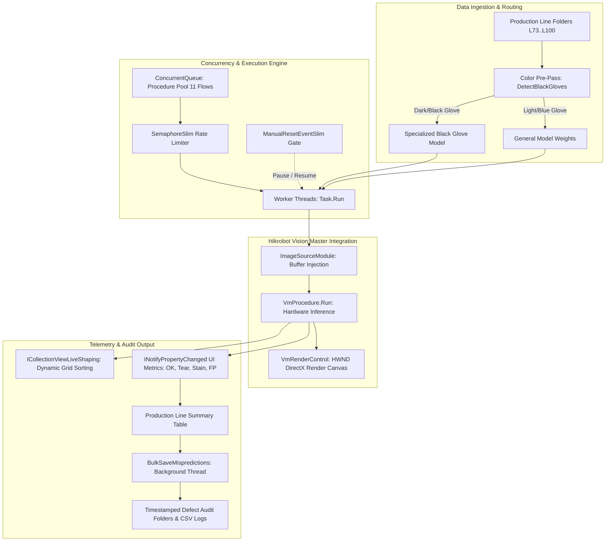

# Glove AI Performance Tracker (Vision AI Command Center v2.0)

[](https://dotnet.microsoft.com/)
[](https://docs.microsoft.com/dotnet/csharp/)
[](https://microsoft.com/windows)
[](https://docs.microsoft.com/dotnet/desktop/wpf/)
[](https://www.hikrobotics.com/)
[](LICENSE)

> **High-throughput, multi-line industrial vision inspection and AI model validation command center built with C#, WPF, and the Hikrobot Vision Master SDK.**

---

## 📌 Executive Summary & Industrial Context

In modern high-speed glove manufacturing facilities, ensuring sub-millimeter defect detection across dozens of production lines simultaneously (e.g., lines `L73` through `L100`) requires continuous, automated validation of deep learning vision models against massive batches of production imagery.

The **Glove AI Performance Tracker** is an industrial workstation application engineered to:
- **Benchmark AI Detection Models**: Rapidly evaluate object detection and defect classification accuracy across simultaneous production lines.
- **Support Dual Inspection Stages**: Accommodate both **PRE** (pre-vulcanization / former inspection) and **POST** (post-stripping / finished exam gloves) production phases.
- **Detect Multiple Defect Classes**: Real-time identification of **Tears**, **Pinholes**, **Surface Stains**, **Bead Rolling Issues (Beading)**, and **Strip Defects (BadStrip)**.
- **Automate Audit & Retraining Pipelines**: Automatically isolate, triage, and export false positives and false negatives to dedicated dataset folders for model retraining and fine-tuning.

---

## 📸 Visual Showcase & UI Walkthrough

| Welcome & Initialization | Model & Line Configuration |
|:---:|:---:|
|  |  |
| *Modern dark-mode command center with active server handshake.* | *Configures PRE/POST mode, batch folders, and model weights.* |

| Multi-Line Dashboard Initialization | Real-Time Hardware-Accelerated Inference |
|:---:|:---:|
|  |  |
| *Dynamic 2-column grid embedding Hikrobot render controls.* | *Live affine bounding boxes, confidence scores, and ~12ms latency.* |

| Production Line Summary & Metrics | Automated Defect Export & Triage |
|:---:|:---:|
|  |  |
| *Yield percentages, total counts, and completed line statuses.* | *Asynchronous background export of misclassified images.* |

---

## 🛠️ System Architecture & Engineering Highlights



### 1. High-Performance Procedure Object Pooling
Instantiating deep learning pipelines and COM-interop SDK objects is computationally expensive. This system implements thread-safe procedure pooling using `ConcurrentQueue<VmProcedure>`, managing up to **11 concurrent Vision Master flow instances**:
- Dynamic dequeue and return pattern prevents SDK memory leaks and access violations.
- Fallback queuing dynamically reassigns idle flows if one model category has completed earlier than others.

### 2. Intelligent Dynamic Model Routing (Black vs. Standard Gloves)
Dark-colored nitrile gloves produce different spectral reflectance compared to white or blue latex gloves.
- Before launching the main inference pipeline, a lightweight color-measurement procedure (`C3Mean` channel extraction via `IMVSColorMeasureModuTool`) analyzes sample imagery from each line.
- The system automatically detects glove color and dynamically routes the line to specialized dark-surface deep learning models without manual operator intervention.

### 3. Non-Blocking Multithreaded Synchronization
- **`SemaphoreSlim(11)`**: Limits concurrent SDK executions to prevent CPU/GPU saturation.
- **`ManualResetEventSlim`**: Enables immediate, zero-overhead **Pause/Resume** thread gating across all running lines.
- **`CancellationTokenSource`**: Facilitates instant, graceful cancellation during system resets.
- **Asynchronous UI Updating**: Background workers push statistical updates via WPF's `Dispatcher.BeginInvoke`, ensuring a butter-smooth 60 FPS user interface while processing high-resolution images at ~12ms latency.
- **Live-Shaping UI**: Implements `ICollectionViewLiveShaping` to dynamically keep active ("Running") production lines at the top of the viewport.

### 4. Hardware-Accelerated Industrial Rendering
Integrates Hikrobot's native **`VmRenderControl`** directly into the WPF visual tree:
- Displays sub-millimeter defect bounding boxes, category tags, confidence scores, and coordinate matrices.
- Streams real-time inference telemetry: image resolution (e.g. `2090 x 1139`), coordinate cursor mapping, RGB pixel inspectors, and per-frame latency.

### 5. Automated Defect Auditing & Continuous Learning Pipeline
- Real-time tallying of production statistics:
  - **OK / OK-NG / OK %**: Accurate acceptances vs. false rejections.
  - **Tear / Tear-OK / Tear %**: Detected tears, pinholes, and beadings vs. missed defects.
  - **Stain / Stain-OK / Stain %**: Detected surface stains and chemical discolorations.
  - **FP / FP-OK / FP %**: False positive defect readings.
- **Asynchronous Audit Exporter**: With a single click, all false positives and false negatives are copied in the background into timestamped directory hierarchies:
  ```text
  Misdetected Image_YYYYMMDD_HHMM/
  ├── L73/
  ├── L74/
  │   ├── FP/       # False Positives (Good gloves flagged as defects)
  │   ├── Stain/    # Misclassified Stains
  │   └── Tear/     # Misclassified Tears / Holes / Beading
  └── L100/
  ```
- **Audit CSV Generation**: Automatically generates `{LineName}_Debug.csv` with timestamps, file names, ground truth folders, and predicted class names for model auditing.

---

## 📁 Repository Structure

```text
├── .gitignore                          # Visual Studio & .NET ignore rules
├── LICENSE                             # MIT License
├── README.md                           # Project overview & architectural guide
├── PerformanceTracker.sln              # Visual Studio Solution (VS 2019 / VS 2022)
├── PerformanceTracker.slnx             # Modern XML Visual Studio Solution
│
├── PerformanceTracker/                 # Main WPF Application Project
│   ├── PerformanceTracker.csproj       # Project file (.NET Framework 4.8, x64)
│   ├── App.xaml / App.xaml.cs          # Application entry point & resources
│   ├── MainWindow.xaml                 # Main Command Center UI layout
│   ├── MainWindow.xaml.cs              # Multi-line orchestrator & procedure pooling
│   ├── LoadConfigWindow.xaml           # Configuration modal UI
│   ├── LoadConfigWindow.xaml.cs        # Parameter & path binding logic
│   ├── ProductionLIne.cs               # Production line state machine, counters & export logic
│   ├── packages.config                 # NuGet package definitions
│   ├── Properties/                     # Assembly metadata & settings
│   └── Resources/                      # UI icons and solution templates
│       ├── favicon.ico
│       └── Solutions/
│           ├── ExamPost.solw           # Hikrobot Vision Master Post-Exam flow
│           └── ExamPre.solw            # Hikrobot Vision Master Pre-Exam flow
│
├── PerformanceTrackerInstaller/        # Visual Studio Deployment & Setup Project
│   └── PerformanceTrackerInstaller.vdproj
│
└── docs/                               # Documentation & Assets
    ├── USER_MANUAL.md                  # Comprehensive step-by-step user manual
    └── images/                         # UI screenshots and export diagrams
        ├── 01_welcome_screen.png
        ├── 02_configuration_dialog.png
        ├── 03_dashboard_grid.png
        ├── 04_realtime_inference.png
        ├── 05_production_line_summary.png
        ├── 06_export_background_modal.png
        ├── 07_export_folder_icon.png
        ├── 08_export_lines_folders.png
        └── 09_export_defect_categories.png
```

---

## ⚙️ Hardware, SDK & License Notice

> [!IMPORTANT]
> **Industrial Hardware & License Dependency**:
> This software is an enterprise-grade industrial automation tool developed against the **Hikrobot Vision Master (VM) SDK (v4.1.0 - v4.3.0)**.
> - In live industrial deployments, executing inference requires the **Hikrobot VM Server background service** and an authorized **Hikrobot USB Hardware License Dongle**.
> - **Portfolio Notice**: Because the physical USB hardware dongle remains with the factory/employer, live camera and model execution cannot be run outside the licensed production environment. This repository is hosted for **portfolio demonstration**, highlighting software architecture, multithreaded systems design, industrial computer vision integration, and enterprise WPF dashboard development.

---

## 💻 Tech Stack & Dependencies

- **Language / Framework**: C# 7.3, Microsoft .NET Framework 4.8 (x64)
- **GUI Engine**: Windows Presentation Foundation (WPF), XAML, WPF-UI
- **Vision Platform**: Hikrobot Vision Master SDK (`VM.Core`, `VM.PlatformSDKCS`, `VMControls.WPF.Release`, `ImageSourceModuleCs`, `IMVSCnnDetectModuCs`, `IMVSColorMeasureModuCs`)
- **Concurrency**: `System.Collections.Concurrent`, `System.Threading.Tasks`, `SemaphoreSlim`, `ManualResetEventSlim`
- **Dialogs & Shell**: Windows API Code Pack (`Microsoft.WindowsAPICodePack.Dialogs`)

---

## 📖 User Documentation

For a detailed walkthrough of all features, configuration parameters, and operator controls, consult the [Glove AI Tracker User Manual](docs/USER_MANUAL.md).

---

## 📄 License

This project is licensed under the [MIT License](LICENSE).
