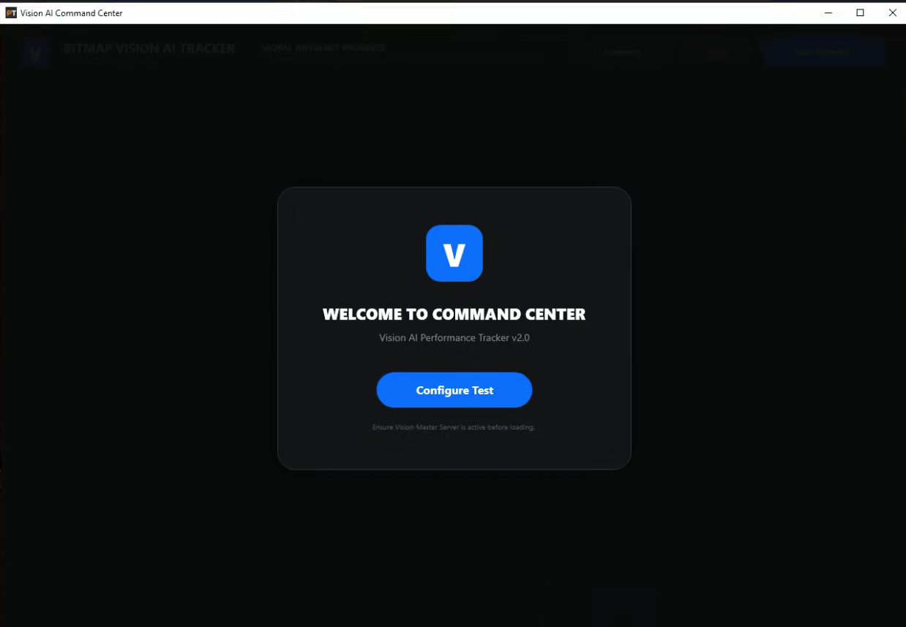
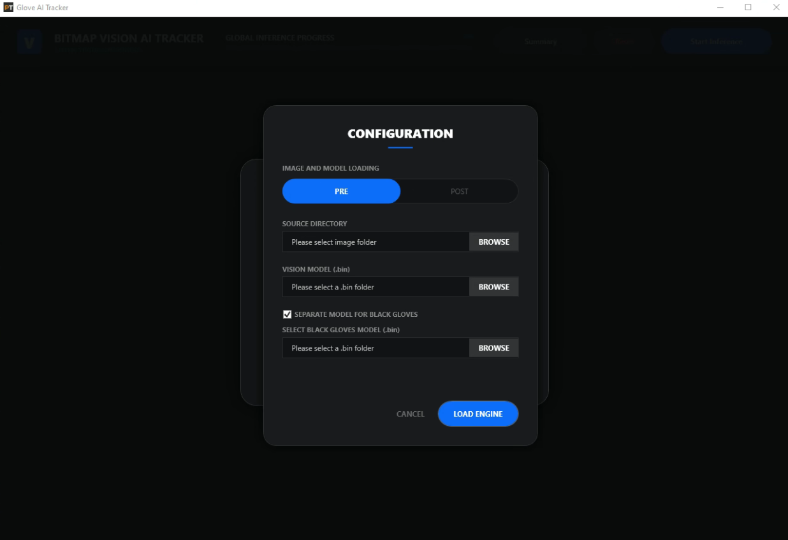
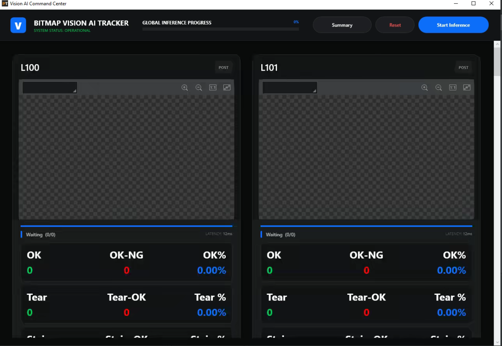
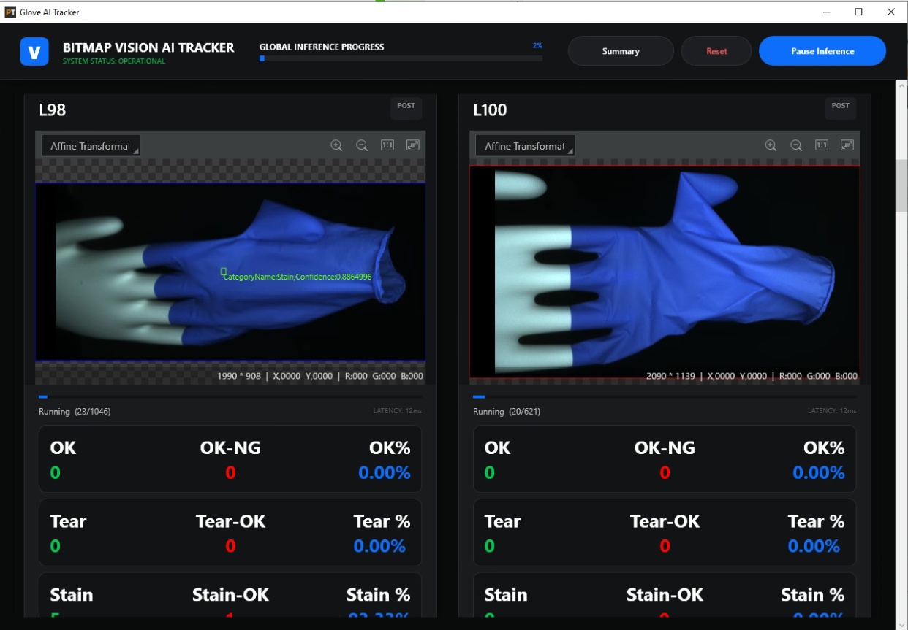
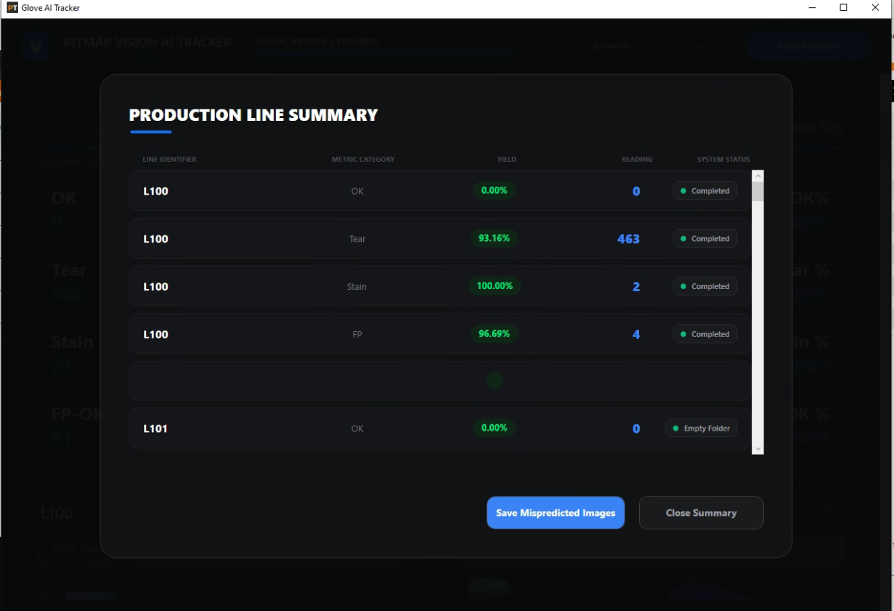
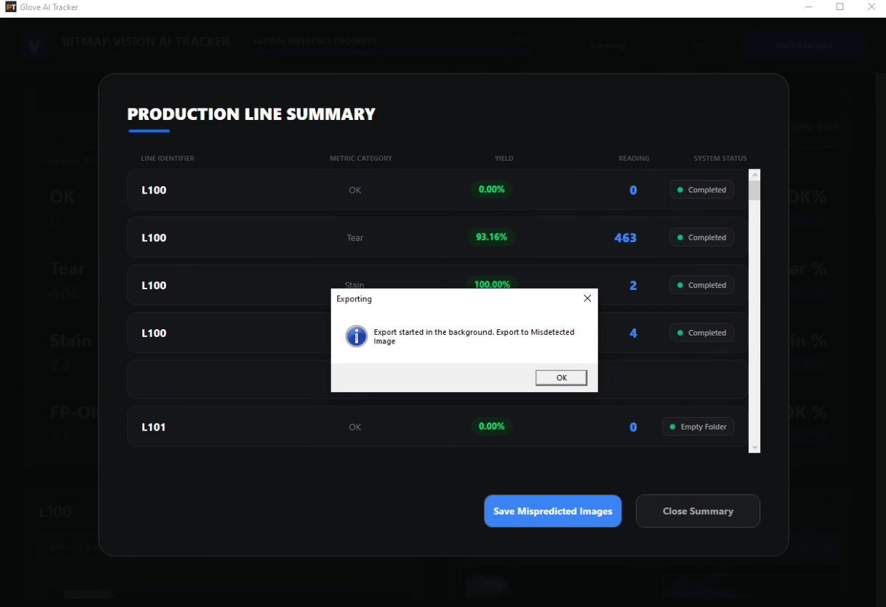

# Glove AI Tracker - User Manual

The **Glove AI Performance Tracker** (Vision AI Command Center) is an industrial-grade computer vision application built on the **Hikrobot Vision Master (VM) SDK** and **WPF (.NET Framework 4.8)**. It is designed for high-throughput automated validation, performance benchmarking, and defect analysis of deep-learning vision models across multi-line glove manufacturing environments.

---

## 1. Application Launch & Main View

Upon starting the application, the system presents the **Vision AI Command Center** welcome screen. 

Ensure that the **Vision Master Server** background service is active before initializing the engine.



- Click **Configure Test** to open the setup and model loading modal.

---

## 2. Configuration Modal

The configuration modal allows operators and QA engineers to define the inspection mode, data sources, and AI model weights.



### Configuration Options:
1. **Inspection Mode (PRE / POST Toggle)**:
   - **PRE**: Loads the pre-vulcanization / former inspection workflow (`ExamPre.solw`).
   - **POST**: Loads the post-stripping / finished glove inspection workflow (`ExamPost.solw`).
2. **Source Directory**:
   - Click **BROWSE** to select one or more production line image folders (e.g., `L73`, `L74`, `L100`).
   - You can select individual line folders or a parent folder containing multiple `Lxx` line subdirectories. The system automatically detects and enumerates all available production lines.
3. **Vision Model (.bin)**:
   - Select the trained Hikrobot AI model binary (`.bin`) for defect classification and object detection.
4. **Separate Model for Black Gloves**:
   - Check the **"SEPARATE MODEL FOR BLACK GLOVES"** checkbox if the production batch contains black nitrile/latex gloves.
   - Click **BROWSE** to specify the specialized dark-surface defect detection model (`.bin`).
5. **Load Engine**:
   - Click **LOAD ENGINE** to initialize the Vision Master solution, allocate procedure pools, and generate thumbnail previews.

---

## 3. Production Line Dashboard & Engine Initialization

Once the engine loads, each production line is assigned a dashboard card within a multi-column responsive grid layout.



- Each card contains an embedded **`VmRenderControl`** hardware-accelerated canvas.
- The system automatically runs an initial color measurement check (`C3Mean`) on the first image of each line to determine whether the glove is light-colored or black, routing it to the appropriate model pool.
- Wait until all **VM Render Controls** have finished initializing before starting inference.

---

## 4. Real-Time Inference Execution

Click **Start Inference** in the top navigation bar to begin parallel processing across all configured production lines.



### Key Display Indicators:
- **Global Inference Progress**: Visual progress bar at the top tracking overall batch completion.
- **Hardware-Accelerated Render Canvas**: Displays the glove image, affine transformation boundaries, defect bounding boxes, classification labels, and confidence scores (e.g., `CategoryName: Stain, Confidence: 0.8864996`).
- **Telemetry Info**: Image resolution (e.g., `2090 * 1139`), coordinate cursor mapping, RGB color channels, and inference latency (e.g., `12ms`).
- **Real-Time Statistical Counters**:
  - **OK / OK-NG / OK %**: Accurate acceptances vs. false rejections.
  - **Tear / Tear-OK / Tear %**: Detected tears, holes, and edge beadings vs. missed tears.
  - **Stain / Stain-OK / Stain %**: Detected surface stains and discolorations.
  - **FP / FP-OK / FP %**: False positive defect readings.

### Controls:
- **Pause Inference**: Temporarily halts the image feed across all lines without losing state. Click **Resume Inference** to continue.
- **Reset**: Stops all background worker threads and resets all metrics and views to the welcome screen.
- **Summary**: Opens the aggregate production performance summary.

---

## 5. Production Line Summary

Click the **Summary** button at any point during or after inference to inspect a detailed metric breakdown.



The summary table groups metrics by line identifier (`L100`, `L101`, etc.) and displays:
- **Metric Category**: `OK`, `Tear`, `Stain`, `FP`
- **Yield (%)**: Accuracy and detection yield percentages
- **Reading**: Total defect counts
- **System Status**: `Completed`, `Running`, or `Empty Folder`

---

## 6. Exporting Mispredicted Images & Audit Data

To facilitate model retraining and root-cause defect analysis, the software provides an automated background export tool for misclassified images.



1. Click **Save Mispredicted Images** in the Summary view.
2. Select an output destination directory.
3. The application generates a timestamped audit folder (e.g., `Misdetected Image_20260124_1900`).
4. An alert confirms: *"Export started in the background. Export to Misdetected Image"*.

### Output Directory Hierarchy:

Images are cleanly segregated by Production Line ID and further partitioned by defect discrepancy category:

```text
Misdetected Image_20260124_1900/
├── L73/
├── L74/
│   ├── FP/         # False positives (good gloves flagged as defects)
│   ├── Stain/      # Misclassified or missed stains
│   └── Tear/       # Misclassified or missed tears / holes / beading
├── L75/
├── L76/
└── L100/
```

In addition, comprehensive CSV execution logs are automatically exported to the application's `DebugLogs/` directory:
- `{LineName}_Debug.csv`: Records `Timestamp`, `FileName`, `ExpectedFolder`, and `DetectedClassName` for every single processed image.
